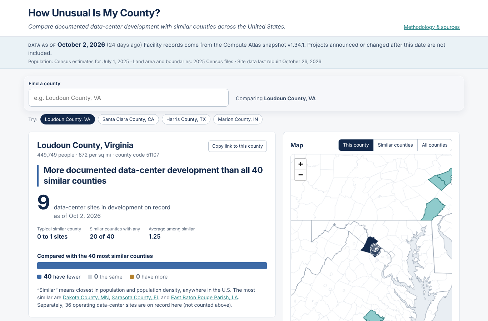
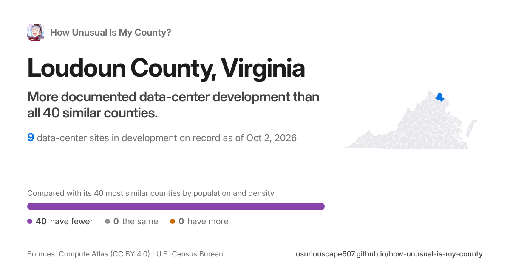

# How Unusual Is My County?

Compare documented data-center development with similar counties across the United States.

Pick any county in the 50 states or DC. The site shows how many qualifying data-center pipeline records
(proposed, permitted or under construction) are documented there in a pinned
[Compute Atlas](https://github.com/ek33450505/compute-atlas) snapshot. It compares that count with the
40 counties most similar in population and population density, and explains the result in plain language.
**Live site:** https://usuriouscape607.github.io/how-unusual-is-my-county/

Everything is precomputed in Python and served as static files: there is no backend, database, API key or
live AI.

- How the numbers are made: [METHODOLOGY.md](METHODOLOGY.md)
- Sources, versions, licenses: [DATA_SOURCES.md](DATA_SOURCES.md)
- AI explanations and their checks: [AI_EVALUATION.md](AI_EVALUATION.md)
- Test results: [TEST_RESULTS.md](TEST_RESULTS.md) · what shipped: [COMPLETION_REPORT.md](COMPLETION_REPORT.md) · implementation log: [NOTES.md](NOTES.md)



Link preview for a county, as shown on X, Facebook, WhatsApp, iMessage and Discord:



## Requirements
- Python 3.11+ with the packages in `requirements.txt` (pandas, GeoPandas, Shapely ≥ 2.1, pyogrio, pyproj,
  requests, pytest)
- Node.js 18+ and npm
- For the link-preview images: Chromium via Playwright (`npm i --no-save playwright && npx playwright install chromium`).
  Without it the build still works and previews fall back to the small icon card.

## Build the data
```bash
pip install -r requirements.txt
python scripts/build_all.py            # download → counties → facilities → peers → export → validate
```
If your network cannot reach `www2.census.gov`, download the three Census files listed in
[DATA_SOURCES.md](DATA_SOURCES.md) by hand, save them in `data/raw/` under the listed names, and run:
```bash
python scripts/build_all.py --offline  # never touches the network; verifies schemas and records SHA-256
```
Outputs go to `public/data/`. QC reports go to `data/processed/` (`qc_counties.json`, `qc_facilities.json`,
`assignment_review.csv`, `validation_report.json`).

## Run the website
```bash
npm install
npm run dev        # http://localhost:5173
npm run build      # static site in dist/
npm run preview    # serve dist/ locally
```
Each county has its own address, `c/<GEOID>/` (e.g. `c/51107/`), which is what the address bar and **Copy link**
show. The build writes the app once per county there (`previews/plugin.ts`), with that county's result in its Open
Graph tags and its own 1200 × 630 image (`og/<GEOID>.png`, rendered from `previews/card.html` with headless Chromium,
cached in `.cache/share-images/`), so X, Facebook, WhatsApp, iMessage, Discord, Slack and LinkedIn show a large preview (crawlers don't run JavaScript, and a
static host serves the same page for every `?county=` value). Older `?county=<GEOID>` links still work and switch to
the county address on load. Link previews need absolute URLs; the build uses the GitHub Pages address unless
`SITE_URL` is set (e.g. `SITE_URL=https://example.org/county/ npm run build`). The Share menu also prints a county summary,
downloads the similar-counties table and the county's records as CSV, and gives iframe code for news sites:
`?county=<GEOID>&embed=1` shows a compact card with the data date, source credit and a link to the full site.
**Find a project** searches every Compute Atlas record in the snapshot and says whether it is counted, where, or
why not (`public/data/projects.json`, loaded only when someone searches).

## Languages
The interface is available in English, Spanish, Korean (Hangul, and mixed script with hanja), Chinese (Traditional for
Taiwan, Simplified), Japanese, Hungarian, Polish and Swedish, chosen from the globe button in the header (a popover on
desktop, a bottom sheet on phones). The choice is remembered, shown in the address as `?lang=` so links open in the same
language, and a visitor's browser language is used on a first visit. County, state and project names stay in English,
so search always takes Latin letters. The methodology section and the three AI examples are English only (the page
says so). All text lives in `src/i18n/en.ts`; each translation file overrides what it translates and falls back to
English for anything missing. **The translations were written with AI and have not been reviewed by native speakers.**
Unit tests check that every language covers every message and keeps every number and name it is given.

## Tests
```bash
python -m pytest -q          # logic tests + data/comparison checks on the built outputs
npm test                     # search, template-summary and translation tests
npm run build && npm run test:e2e   # Playwright smoke test (desktop + mobile)
```
The end-to-end test needs Playwright with Chromium. If it is not installed globally:
`npm i -D playwright && npx playwright install chromium`.

## Deployment and weekly data refresh
The site is deployed to GitHub Pages by `.github/workflows/rebuild-and-deploy.yml`:
- **Every Monday:** checks for a newer Compute Atlas release. If there is one, it rebuilds all data from the
  official sources, runs every check (pytest, validation, frontend tests, Playwright), commits the new data to
  `main` and deploys. If nothing is new, it does nothing.
- **Every push to `main`:** tests and deploys the committed data and code.
- **Manual run** (Actions → Rebuild and deploy → Run workflow): tick *rebuild_data* to force a full rebuild.

Nothing deploys unless every check passes, so a failed refresh leaves the last good site online. After a data
change, the three AI examples no longer match the data. The site hides them (the template summary still appears)
and the run shows a warning until they are regenerated (see AI_EVALUATION.md).

One-time setup: repository **Settings → Pages → Build and deployment → Source: GitHub Actions** (the repository
must be public, or on a paid plan).

To use another static host instead, run `npm run build` and upload the self-contained `dist/` folder (relative
paths, data included). No environment variables or credentials are needed.

## Repository layout
```
scripts/   download_data, prepare_counties, process_facilities, calculate_peers, export_web,
           validate_data, build_all, build_ai_examples, common
data/raw/  manifest.json (source files are downloaded here, not committed)
data/processed/  intermediate tables and QC reports
public/data/     counties.geojson, states.geojson, county_metrics.json, county_peers.json,
                 facilities.json, metadata.json, ai_examples.json
ai/        prompt and the three example inputs/outputs/verification notes
src/       React + TypeScript app (components/, lib/)
tests/     pytest suites and tests/e2e/smoke.mjs
```

## Attribution
Compute-infrastructure data from Compute Atlas by Edward Kubiak, licensed under
[CC BY 4.0](https://creativecommons.org/licenses/by/4.0/) — https://github.com/ek33450505/compute-atlas.
The data were filtered, assigned to counties and counted (see DATA_SOURCES.md). Population, land area and
boundaries: U.S. Census Bureau (public domain). Map rendering: Leaflet. Charts: Recharts. Preview-image type: Inter (SIL Open Font License).
